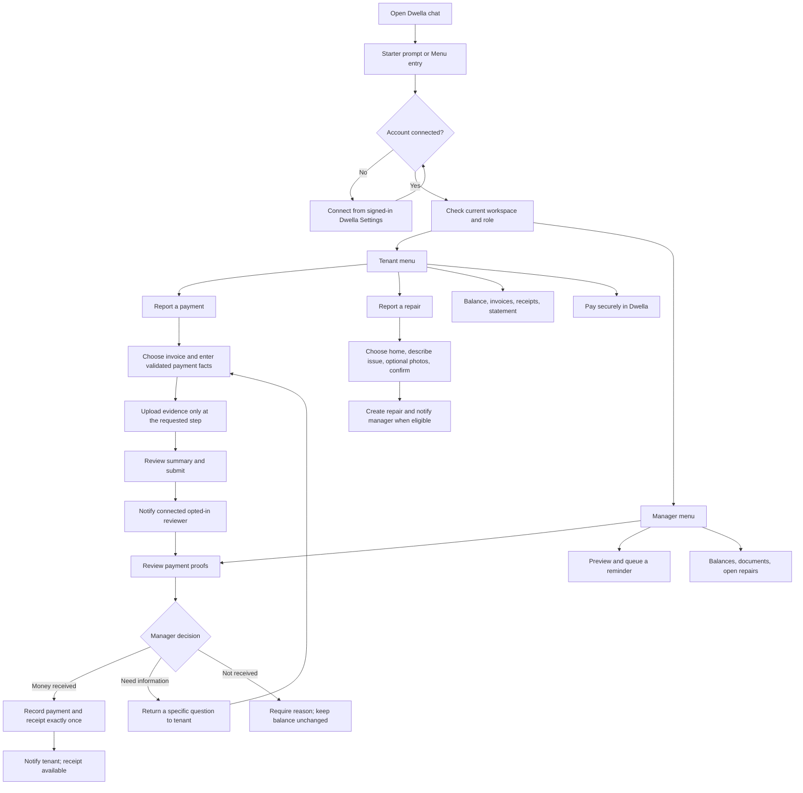

# WhatsApp flow audit and proposed menu-first experience

Audited against the implemented conversation adapter, payment-proof services,
notification renderers and the enabled test environment on 6 November 2026.
This document distinguishes existing behavior from a proposed interaction change.

## Current flows

| Journey | Tenant | Property manager | Current behavior |
|---|---|---|---|
| Connect account | Yes | Yes | Prove phone ownership from signed-in Dwella Settings; then use current workspace permissions. |
| Balances | Own open-invoice total | Workspace open-invoice total | Exact recorded balance. The manager summary does not list individual debtors. |
| Invoices and receipts | Own records | Workspace records | Lists, detail, secure website link and requested PDF attachment. |
| Current-month statement | Yes | Website reports | Tenant current-month PDF; arbitrary periods are selected on the website. |
| Pay rent | Secure website checkout | Not a tenant payment action | Select an invoice, then follow a Dwella payment link. No payment credentials collected in chat. |
| Report a direct payment / POP | Yes | Review it | Guided facts and evidence; confirmation required before submission. |
| Review POP | Await result / answer question | Confirm, reject or ask for information | Same authoritative payment-proof services as the website. |
| Repairs | Report with optional draft photos; view open status | View open requests | Tenant explicitly confirms the repair; manager assignments and updates remain on the website. |
| Rent reminder | Receive when connected and opted in | Preview and explicitly queue | Sending follows consent, approvals, quiet hours and the existing messages job. Queueing is not delivery. |
| Create invoice | No | Website only | The menu still exposes a website handoff; no native WhatsApp invoice creation. Deferred beyond beta. |

Payment, invoice, payout, repair, lease-ready and connection notices have renderers.
The eleven English template names are approved and configured on test. Each send
still depends on its own event, current permissions, opt-in and transport guards.
Generic operational notices and reminders use scheduled dispatch; payment-proof
review templates use the dedicated responsive notice lane.

## POP -> manager -> payment

1. The connected tenant chooses **I have already paid**, sends **POP**, or currently
   sends a standalone evidence attachment that starts the guided proof flow.
2. Choose an unpaid invoice; confirm amount, method, payment date and reference.
3. Attach evidence. Bank/mobile-money reports need a file; cash evidence is optional.
   Dwella does not read the screenshot to invent payment facts.
4. Review the summary and choose **Confirm**. This submits a report; it does not
   change the invoice balance.
5. Dwella queues `dwella_payment_proof_review` for the designated connected reviewer,
   or falls back to connected managers when that reviewer is unavailable. Proactive
   notices need each recipient's opt-in. Unconnected managers can still review on
   the website; sending a WhatsApp report does not create their account connection.
6. **Review proof** opens the facts/evidence and **Confirm received**. The manager
   checks that the money arrived, then confirms. The same transaction-safe service
   records the payment, updates the outstanding balance and issues its receipt.
   Repeating the same confirmation returns the existing result.
7. **Not received** requires a reason. **Ask for details** requires a question and
   allows the tenant to correct/resubmit. Neither records a payment.
8. The tenant receives the outcome notice when eligible. The receipt is available
   from **My receipts**, including its PDF.

The adapter is registered in the deployed app. Both pilot roles are connected and
opted in, and the relevant templates are approved. A subsequent live pilot check
confirmed a WhatsApp-origin proof with evidence, a confirmed payment and a receipt;
both its reviewer notice and tenant confirmation had reached read status. This
demonstrates the main submission/confirmation path. Rejection, information requests
and changed-access cases remain separately tested behaviors, not additional
handset outcomes inferred from that one confirmation.

## What is not wired into chat

- Native **Create invoice**: the adapter intentionally hands off to the website.
- Native money collection: **Pay rent** opens secure Dwella checkout.
- Native WhatsApp Flows forms (`nfm_reply` submissions), entry prompts and a strict
  menu-first policy: not implemented/configured by the current conversation code.
- In-chat lease signing, lease amendments, move-out, renewals, reimbursements,
  payouts, receiving-detail changes and account administration: website actions or
  deferred scope, not supported chat commands.
- General AI/Handy conversations, voice/video/location/contact handling and OCR
  payment approval: not implemented. Some are intentionally outside the beta.
- Automatic payment confirmation from an image: deliberately prohibited. A person
  must confirm receipt of the funds.

The exact generic fallback **This is not on WhatsApp yet. You can do it in Dwella**
is in the money adapter's unsupported-intent branch. With the current menu this is
the **Create invoice** handoff. The separate **payment setup is being completed**
fallback is only used when the whole money adapter is missing; the live adapter
check passed. No such fallback rows were found in the sampled pilot history, so
this source mapping does not identify which particular screen the user saw.

## Proposed: menu-first, not an unrestricted assistant

This is a design proposal. It is **not** activated by the typing/read-receipt work.
WhatsApp retains its composer: Dwella cannot replace the customer's app with a
locked kiosk. We control what Dwella accepts and acts upon.

[Open the drawn flow](diagrams/whatsapp-menu-first.svg).

Use supported starter prompts where available and a **Menu** entry link. A tap or
message routes through identity and current workspace checks before showing a
role-specific menu. Do not depend on a callback simply because a user opens an
existing chat. Welcome-event behavior needs current Meta/account verification.

The chat should accept free text only for an expected field, such as an amount,
reference, repair description or review reason. Outside an active input step,
unrecognized messages return **Please choose an option below** with the safe menu.
Unsolicited attachments should not automatically start payment proof: first choose
**Report a payment** or **Report a repair**, then accept the requested file type.
Current opaque choices, expiry checks and backend validation remain authoritative.

Always allow **MENU**, **CANCEL/BACK**, and **STOP/UNSUBSCRIBE**. Cancellation affects
the unsubmitted draft; STOP revokes the connection/consent. A menu policy must never
swallow opt-outs. Show website actions as website handoffs, rather than exposing
dead-end **not set up** replies.

Start with the existing buttons/list architecture for beta. Native WhatsApp Flows
can later collect amounts, dates and references in a structured in-app form; this
needs separate form/response-token validation and deployment. Publishing a Meta
Flow or enabling entry prompts is a separate implementation step, not a side effect
of drawing this proposal.

## Typing and read receipts

`APP_WHATSAPP_TYPING_ENABLED` defaults false. When enabled, the worker marks the
genuine inbound message read and requests WhatsApp's native typing indicator after
claiming an authorised linked reply, outside database transactions. The status
call uses a short socket timeout, refuses redirects, has no retries and does not
determine whether the actual reply was sent. A failure still allows the reply.
Consent/access are rechecked after the status call. Unlinked connection notices
and opt-out acknowledgements do not emit typing feedback. No artificial pause is
added to make the animation last longer.
