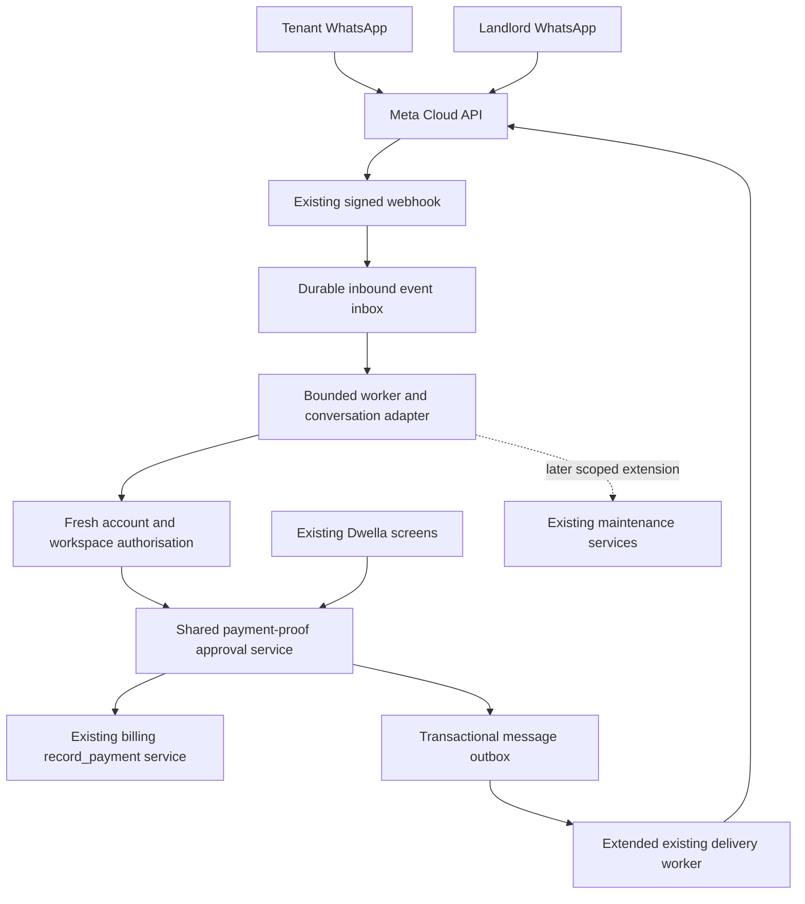

# WhatsApp self-service alongside Dwella

Date: 2026-10-31

Status: architecture proposal for review; no application implementation or activation authorised.

Scope: an additional channel for existing tenant/manager workflows, starting with direct-payment proof and receipt confirmation. Maintenance is the next bounded extension.

## 1. Recommended approach

Use one dedicated Dwella WhatsApp Business Platform number through the direct Meta Cloud API already used by the repository. Add a small, deterministic conversation adapter inside the existing Django application. Reuse PostgreSQL, the database-backed messaging queue and the existing worker deployment pattern. No new chatbot vendor, broker, microservice or AI dependency is needed for the first release.

WhatsApp identifies the linked actor and collects an explicit action; the billing and maintenance services remain authoritative. Website and WhatsApp operations act on the same request. Existing provider checkout remains available. Direct payment means money went to the landlord outside Dwella; it creates no Lenco collection, platform balance, settlement or payout obligation.

The first release supports tenants submitting proof and landlords confirming receipt from WhatsApp or Dwella. It is not a general chat inbox. Repairs, balances and document requests can reuse the channel foundations only after their individual scope is agreed.

Delivery is at least once; database constraints and atomic domain operations make repeated delivery safe. Do not promise exactly-once network delivery.

## 2. What exists and what must change

Repository inspected on 2026-10-31; this is source evidence, not proof of production enablement.

| Existing component | Reuse | Required addition or constraint |
| --- | --- | --- |
| `backend/apps/notifications/provider_webhooks.py` | Signature verification, business/number checks, delivery status handling, inbound-window timestamps and STOP | Durable inbound message IDs, action routing and media intake; currently no action conversation/history |
| `notifications/phone_messaging.py` | Direct Meta sender, phone normalisation, exact-number consent, allowlists, runtime controls | Verified user binding for both roles, approved action templates, reply buttons and media delivery |
| `notifications/models.py`, `messaging.py`, `run_messages` | Durable delivery rows, unique identity, bounded claim/send cycle, uncertain-send review | Manager recipients, message purpose, retry metadata, inbox processing and action-aware freshness checks |
| `billing/services.py::record_payment` | Positive amount, invoice lock, void/balance checks, payment and receipt reference, total refresh | Shared pending-proof approval wrapper; the existing direct manual-recording endpoint also needs overlap detection |
| `billing/services.py::reverse_payment` | Audited manual-payment correction and provider-payment reversal protection | Link correction visibility to the original confirmed proof; do not reopen proof and create another payment |
| `portal/access.py`, `common/workspaces.py`, organisation memberships | Tenant linkage, mailbox proof, suspension and workspace rules | Reusable actor/context authorisation usable by web and worker paths, without fabricating an authenticated webhook request |
| `maintenance/services.py` and portal maintenance endpoints | Requests, comments, transitions and photo validation | Later adapter, reusing the same tenant scope and visibility rules |
| Audit services and private-table migrations | Actor/workspace audit trail; restricted messaging tables | Explicit channel/event attribution and matching access restrictions for new tables |

Important implementation traps:

- `MessageDelivery.tenant` is required, and the dispatcher assumes that tenant is the recipient. A tenant-related payment review sent to a manager cannot be represented safely by merely changing the destination phone.
- `send_whatsapp` currently treats any delivery with `invoice_id` as a rent reminder. `dispatch_block` also checks invoice reminder dates and settings. Add an explicit purpose/template renderer before sending proof approvals or receipts with invoice links, so reminder logic does not cancel or misrender them.
- Current consent is not evidence of account pairing. Current tenant profile numbers must not be treated as authority to act.
- Existing transport reduces HTTP rejection to a code and cannot safely support detailed retries yet. Preserve enough bounded, redacted error metadata to classify retries; do not change all messaging transports indiscriminately.

## 3. Identity and permissions

Both parties use Settings → Notifications → Connect WhatsApp. For the first release, require an existing signed-in, mailbox-verified Dwella account; tenants must already have accepted their invitation and have a `Tenant.user` link.

1. User enters/confirms an E.164 WhatsApp number in Dwella and creates a random, single-use pairing challenge. Store its digest, account, intended number, expiry and attempt count. Proposed expiry: 10 minutes; maximum five failed attempts, with per-account/number/IP rate limits.
2. A link opens the dedicated Dwella conversation with the challenge prefilled. The user must send it. Only a valid signed inbound event from the intended number can claim the challenge.
3. Show the detected number in the still-authenticated Dwella account and require completion there. Consume the challenge atomically and create the verified binding. This final account-side step protects against an accidentally forwarded pairing link.
4. Record consent separately and explicitly for proactive notifications. Receiving a message proves control at that moment; it does not independently grant account access or future messaging permission.

One active number binds to one Dwella user; that user can retain their existing multiple workspace/tenancy memberships. First release excludes shared family/team WhatsApp identities. A shared number already bound to another user produces a generic conflict and account-side recovery, not disclosure of that user's identity.

Each action resolves the verified binding and rechecks active user, mailbox/access state, active workspace, current role, tenant linkage and target object permissions. A manager phone is a personal account binding, never the organisation's general contact number. Platform admins/support sessions do not gain WhatsApp financial approval powers.

The current `resolve_workspace` selects the first active membership for ordinary web requests. The adapter must not inherit that implicit choice for a target in another workspace. Extract the shared checks into an explicit actor + workspace context, verify that membership directly, and preserve current website workspace behaviour. Do not broaden website access as a side effect. Keep all new identity, action and evidence tables private from Handy/direct data access, applying the repository's existing restricted-table/RLS migration pattern as well as endpoint permissions.

Explicitly choose workspace and lease/invoice when ambiguous; never guess from a name, screenshot or most recent landlord. Existing historical invoices can be submitted only if still reachable under portal rules; do not require an active lease where the website legitimately allows paying an old balance.

Unlink/relink, relevant account recovery, changed bound number or membership removal revokes action tokens and active conversations. Changing the designated reviewer also revokes outstanding review tokens for that assignment. Tenant contact-number edits must not silently change the WhatsApp binding or the mobile-money wallet. Notify the account in Dwella of binding changes. STOP immediately disables proactive WhatsApp sends and outstanding approval capabilities; completing sensitive actions after STOP requires reconnection or the website. Minimal responses to a new user-initiated help message may remain possible under platform policy; they never silently restore consent.

## 4. Direct-payment proof flow

1. Tenant chooses **Submit payment proof** or sends supported evidence. Unknown/unpaired senders receive only connection instructions; do not download their attachments or reveal tenancy information.
2. Select the authorised workspace, tenancy and invoice. First release: one invoice per proof, positive ZMW amount no greater than the current balance. Capture actual payment method, payment date, external reference if available and optional note. Validate against the same backend rules as website inputs; reject future payment dates and unsupported methods. Cash can be supported later without pretending it necessarily has a screenshot.
3. Download and validate evidence asynchronously. Collect fields with buttons and short prompts. The bot may suggest an invoice from account data, but requires tenant selection/confirmation. No OCR is required. Any later OCR only proposes fields and never approves payment.
4. Show a final summary, including currency, amount, invoice, unit, period, method/date/reference and attachments. **Submit / Edit / Cancel**. Only Submit creates a manager review obligation. Show: **Submitted — awaiting landlord confirmation**. Balance stays unchanged.
5. Persist the proof and unique initial landlord notification in the same database transaction. Select one designated active manager for WhatsApp review per workspace; default to an explicitly chosen current manager, not every team member. All currently authorised managers can still review in Dwella. If no eligible connected manager exists, preserve the request in Dwella and tell the tenant it was submitted there.
6. Send the manager an approved template outside their own service window; the tenant's conversation does not open the manager's window. Include a public proof reference, tenant, workspace/unit, amount and invoice. Buttons: **Review proof / Not received / Ask for details**. Review supplies authorised evidence into the manager's WhatsApp conversation and then presents **Confirm received / Back** with the full summary. This keeps approval usable within WhatsApp and avoids approving before seeing proof. A secure Dwella review link is an additional fallback.
7. Confirm received explicitly means the manager checked that the money arrived. Call the shared approval service using a short-lived actor-bound action token. If accepted, create one ordinary manual billing payment and receipt, attach it to the proof and queue tenant/manager outcome messages atomically. Acknowledge success only after commit.
8. Website approval calls the same service. Old WhatsApp buttons report the current result. Not received/rejection requires a short reason. Ask for details sends a bounded question; the tenant replies against this proof, then reviews and resubmits a new revision.

Example manager review message:

> Mary Banda reports paying ZMW 3,500 for November rent, Rosewood Unit 4, invoice INV-…. Payment method: bank transfer. Paid on: 2026-11-01. Reference: ABC123. Proof: WPR-…. Please review the proof and confirm only after checking receipt of funds.

An approval is attested by the landlord, not verified by a bank or Dwella's payment provider. Store and display that distinction. Messaging/direct-transfer charges may still apply; do not advertise this route as fee-free.

## 5. Data additions and state ownership

Use explicit domain relations rather than a generic model that can mutate arbitrary database objects. Names below are proposals, not existing models.

| Record | Purpose and constraints |
| --- | --- |
| `WhatsAppBinding` | User, normalised number/provider sender ID, verification/revocation timestamps and binding generation; unique active number and active user. Consent remains in `PhoneMessagingConsent`. |
| `WhatsAppPairingChallenge` | Hashed challenge, intended user/number, expiry, attempts, consumed timestamp; bounded lifetime. |
| `WhatsAppInboundEvent` | Unique business-number + provider message ID, sender, provider timestamp, receipt time, minimal private payload, processing state, attempts, next attempt, claim generation/lease and reason. Status callbacks keep their existing monotonic processing. |
| `WhatsAppConversation` | Binding, selected workspace/role, allowlisted intent/step, target reference and version, bounded draft, expiry and last event. One active drafting flow per binding; independent approvals use target-specific tokens rather than one global chat state. |
| `PaymentProof` in billing | Workspace, tenant, lease/invoice, submitter, declared fields, status/revision, timestamps, reviewer/reason, linked payment. Payment relation unique when present; preserve original submitted facts and revisions. |
| `PaymentProofAttachment` | Proof/revision, private storage key, media ID, size/type/digest, validation state and uploader. Never a public media URL. |
| `WhatsAppActionToken` | Hashed opaque random token, binding generation, actor, workspace, target, action, target revision, expiry and consumption result. One token grants one transition, not general API access. |
| Extended `MessageDelivery` | Explicit recipient user/binding and purpose, domain-event identity, template/version, attempt/claim metadata and error classification. Keep tenant as optional subject context. Add a constraint requiring the correct recipient shape and preserve existing tenant-send semantics during migration. |

Proof states: `draft → submitted → confirmed | rejected | needs_information | cancelled`. `needs_information → submitted` requires a new tenant-confirmed revision. A changed/voided/paid invoice routes to `needs_information` with a specific reason or an authorised existing-payment match; never truncate the amount automatically. Tenant cancellation is allowed before confirmation. Confirmed proofs remain linked to their payment; corrections use existing payment reversal with reason and audit.

Do not auto-reject an unresolved financial claim because a chat or token expires. Draft conversations expire after 24 hours of inactivity; manager action tokens expire after 24 hours or immediately on revision/revocation. Fresh tokens can be issued for a still-pending request. Submitted proofs remain visible until resolved. A final-confirmation token should be shorter lived (proposed 10 minutes).

## 6. One approval operation and duplicate protection

The approval wrapper is a domain operation, callable from authenticated web endpoints and a verified WhatsApp actor context. Reuse validation and authorisation; do not call the REST API internally with a fabricated user session.

Proposed transaction:

1. Authorise the live actor and target workspace. Validate action token/sender when using WhatsApp; web uses normal session/authentication and an idempotency key.
2. Lock the invoice first, then the proof, then the action token. Recheck permissions/binding and proof revision inside the transaction. Use this order in every operation that touches these records; review against provider reconciliation's invoice locking before implementation.
3. If already confirmed, return its existing payment/result. Reject contradictory or stale decisions. If an external payment/manual receipt might already cover this proof, require explicit matching rather than creating another receipt.
4. Revalidate invoice eligibility, current exact balance and submitted amount. Call existing `record_payment` with the actual verified manager as `recorded_by`; do not alter checkout or payout accounting.
5. Link the unique resulting payment, record the decision/audit, consume tokens and insert unique outcome delivery rows before commit. Any failure rolls back the whole financial transition.

Inbound provider IDs, proof-to-payment linkage, token consumption and outbox identities prevent technical duplicates. They do not prove that two separately uploaded screenshots describe different payments.

For business duplicates, show same-invoice/amount/date/reference candidates, evidence digest matches and existing provider/manual receipts to the reviewer. Digests and references are warnings, not proof: references can be absent/reused and screenshots can be cropped. The existing **Record payment** website flow must warn about pending matching proofs and offer **Confirm this proof** or an explicit audited existing-payment link. Matching requires same workspace, invoice, tenant, amount/method/reference evidence as appropriate; payment can be linked only once. Never auto-link a provider payment from a screenshot alone. Concurrent provider confirmation may change the balance; keep proof unresolved and ask the manager to reconcile, without altering provider evidence.

Partial payments remain supported; overpayments and multi-invoice allocation use the current website/manual review limits. Proof submission does not mark rent paid, suppress ordinary arrears/late fees or reserve a balance. When a proven on-time payment was confirmed late, show that date to the manager for explicit correction of any resulting fee using existing supported correction operations; do not silently rewrite invoices.

## 7. Webhook, workers and retries

Webhook work is bounded: validate signature and configured business/number, normalise supported events, persist the minimal event under a unique provider ID, apply prompt opt-out/window updates safely, then acknowledge. No media downloads, PDF work, provider sends or billing approvals in the callback. A valid duplicate gets success. A database failure before durable acceptance returns a retryable error. Malformed but authenticated individual events are recorded/quarantined without poisoning valid events in the same envelope; invalid signatures are denied.

Claim inbox rows with atomic compare-and-set/short database locks. Workers commit claims before network I/O and use claim generations so a timed-out worker cannot overwrite a newer worker's result. Process a binding's draft events serially; use provider reply context and expected conversation revision to detect ambiguous/out-of-order input. A late attachment or generic yes cannot silently attach to the next request. Request clarification where ordering cannot be established.

Preserve both provider timestamp and received time. Reject future timestamps beyond the existing five-minute skew allowance. Do not execute a newly received action command older than 24 hours, even if it survived provider retries or local replay; final confirmation must also fit its 10-minute token lifetime. Consumed event IDs/results and target revisions remain authoritative. Late financial evidence can be attached through a new confirmed draft without executing an old approval command.

Use existing worker infrastructure, adding bounded inbox/media stages and targeted outbox dispatch. Proposed invocation bounds: up to 50 events, 45 seconds, 10-second HTTP timeout per request, at most four eligible remote attempts. These are initial budgets to validate, not measured throughput claims. Use independent cursors/time budgets so a media backlog cannot starve approvals, STOP or delivery callbacks. Prefer due media retrieval promptly; do not wait through overnight quiet hours to acquire evidence.

| Failure or event | Proposed behaviour |
| --- | --- |
| Repeated inbound message/button | Unique ID returns existing result; no repeated domain action or notification. |
| Transient local processing failure | Retry approximately 30 seconds, 2 minutes, 10 minutes after initial attempt, with jitter; then dead-letter/review. Atomic commits and event/result links allow recovery after a crash. |
| Media read timeout or expired download URL | Safe GET retry within the same bounded schedule; fetch a fresh provider URL from the media ID. If inaccessible after exhaustion, ask for reupload against the same draft. Do not submit evidence marked incomplete. |
| Provider explicitly rejects a send with a documented transient, non-acceptance error | Retry after provider delay/`Retry-After`, otherwise 30 seconds, 2 minutes, 10 minutes with jitter; maximum four total attempts and within message/token lifetime. Rate-limit per business number and apply configured send budgets. |
| Timeout, broken response, generic server failure or crash after a send may have been accepted | Mark `review` / outcome unknown. Do not blindly resend or assume a generic HTTP 5xx proves non-acceptance. Wait for a correlated callback; otherwise expose review/fallback in Dwella. |
| Known provider ID, no delivered/read callback | Keep accepted/pending delivery; absence of callback/read is not permission to retry. |
| Documented terminal delivery failure | Mark failed; permit an explicit new notification attempt only while the domain request is live, with consent/authority checks. No repeating automated send loop. |
| Authentication/configuration error, paused/rejected template or invalid recipient | Hold/fail with a clear operational reason; alert admin once per incident, await correction. No rapid retries. |
| Worker dies while claimed | Reclaim expired local processing lease safely; uncertain external sends follow the existing needs-review policy. |
| Approval commits but reply fails | Payment stays confirmed. Retry only a safe notification; a repeated approval returns the original receipt. |
| User does not respond | Never auto-confirm or auto-reject. Optional one follow-up after 24 hours and one after 72 hours, only while pending, opted in and within budget/quiet-hour/template rules. This is separate from transport retry. |
| WhatsApp unavailable or opted out | Request remains usable in Dwella. Use existing in-app notification; optional email only under current preferences and delivery controls. No automatic SMS/other paid-channel escalation. |

At every delayed send, recheck recipient binding, consent, role, feature/platform controls, target status/revision and action expiry. Generate fresh recipient-bound tokens at send time. Cancel stale review/reminder messages after the proof resolves. Permit the appropriate final outcome message. Re-evaluate the recipient's 24-hour window and template readiness; never retry yesterday's free-form payload outside its window.

Delivery callbacks can race the send response. Preserve monotonic delivered/read evidence and correlate the existing opaque callback reference; a later worker write must not regress a callback to sent. Extend tests for this existing race as part of dispatcher changes. Delivery, read and business approval are independent states.

## 8. Attachments and private evidence

Start with JPEG/PNG and PDF payment proof, maximum three files at 8 MiB each, with a bounded per-draft/account upload allowance. These are proposed product limits, subject to Meta support and repository storage review. Maintenance should retain its existing validated photo types, eight-photo count, 8 MB and image-dimension limits rather than inherit arbitrary payment-document limits.

Retrieve media only by provider media ID using authenticated official endpoints. Resolve a fresh short-lived URL when required; validate HTTPS hosts and redirects, stream with byte limits/timeouts, and never fetch an arbitrary URL supplied in chat. Do not forward access tokens across redirects/unapproved hosts. Validate real file signatures, image dimensions/decompression limits and PDF structure; reject encrypted/unparseable/active-content documents until safe handling is available. Store under random keys outside public media serving, with authorised streaming/download endpoints. Treat third-party parsers as untrusted and bound their CPU/memory work. Do not claim MIME checks alone establish file safety.

Preserve original financial evidence and its digest; generate safe previews separately, with inline active content disabled. Use private existing storage if it satisfies these requirements; otherwise choose a private storage path as an explicit prerequisite, without adding public buckets or storing every binary in the event table. Unvalidated files remain quarantined and cannot be forwarded/approved. Failed attempts must not create unbounded orphan objects.

Sending evidence into WhatsApp creates a copy outside Dwella's download controls. Explain this to the submitter and forward only to the current designated verified reviewer after authorisation, with no unrelated identifiers or documents. Dwella cannot revoke screenshots or forwarded copies. If safe media handling/templates are not ready, offer authenticated web review rather than pretend WhatsApp-only review is complete.

## 9. Minimal user-facing changes

- Settings → Notifications: connect/disconnect WhatsApp, verified number and proactive-message consent for tenant/manager. Workspace settings add the designated reviewer and an optional direct-payment-proof switch, default off until enabled.
- Existing tenant invoice/payment drawer: **Pay through Dwella** and **Already paid? Submit proof**; show pending proof/status alongside existing payment history, without calling an unconfirmed submission a receipt. Website evidence upload uses the same workflow.
- Existing landlord invoice/payment view: a pending-proof filter/section and review drawer with evidence, matching candidates and decisions. Existing in-app alerts link there. Keep ordinary invoice/receipt/payment states intact.
- Existing admin messaging view: expose failed/unknown inbound/outbound work, reason, attempts and a safe replay action. No new broad operations dashboard required.
- Frontend calls remain in Services through query/mutation hooks. Invalidate relevant proof, invoice, receipt, balance and notification queries after website actions; normal refetch-on-focus/short polling of an open pending review provides cross-channel updates. No new realtime infrastructure initially.

Website endpoints follow the standard response envelope and existing CSRF/authentication conventions. Provider webhook responses retain the provider protocol rather than forcing an API envelope onto Meta callbacks. Frontend security/visual work still needs its existing project-skill and design review workflow before implementation.

## 10. Bounded extension to repairs and other actions

After the payment pilot, add only explicitly enabled intents:

| Action | Reuse and boundary |
| --- | --- |
| Report repair + photos | Confirm tenant's own unit, description/category, access notes and explicit permission to enter; call existing creation service after validation and final Submit. Source remains tenant; audit channel records WhatsApp. |
| Manager receives repair | Send tenant-visible summary/photos to authorised reviewer; acknowledge/request details or start work only through existing valid transitions. Scheduling, vendor assignment and financial charges can remain in Dwella first. |
| Repair comments/progress | Attach to an explicit request reference; tenant receives only non-internal updates. Recheck tenant scope on every read/send. |
| Balance/invoice/receipt lookup | Read live scoped records, paginate choices and rate-limit; private document delivery only after access checks. |

Do not put payouts, bank detail changes, refunds, lease signatures or tenant charges behind generic chat commands. Any future such feature needs its own design. No general LLM agent or Handy database access is needed; later language understanding can propose an allowlisted intent but cannot bypass deterministic validation/confirmation.

## 11. Operations, retention and rollout

Keep credentials in protected environment configuration. Reuse runtime channel switches, template/language approvals, feature policies and test recipient allowlists. Add action-specific templates for manager proof review, clarification, final outcome and later repair events; rent reminders are not interchangeable templates. Direct-payment proof availability should not depend on Lenco availability. Separate global WhatsApp transport enablement from per-workspace action enablement.

Proposed operational retention: minimal inbox payload 30 days, terminal transport attempts 90 days, expired pairing challenges/drafts and unattached quarantined files seven days. Keep provider-ID deduplication tombstones for at least 90 days and reject stale action commands beyond their allowed age even after payload cleanup. Keep submitted/confirmed/rejected financial evidence and decision audit under the existing financial retention policy, subject to explicit retention review; do not purge financial claims as transient chat. Purge in bounded batches, respecting evidence/legal holds and backup policy. Redact tokens, account/bank details, message bodies and media URLs from operational logs.

Monitor oldest due event/notification, counts by failed/held/unknown reason, media failures, processing latency, approval conflicts, duplicates prevented, per-workspace send volume and retention backlog. Support replay must be role-restricted/audited and re-run live authorisation. It cannot manufacture manager consent, reset confirmed claims or blindly resend uncertain sends.

Roll out in small reviewable increments:

1. Approve this architecture and first-release rules; inventory current actor/storage/privacy/worker integration points and measure baseline small/full payment-list queries. No enablement implied.
2. Implement proof/revision/evidence and shared approval in billing, including duplicate/manual-recording integration, API checks and focused tests. Existing payment ownership remains Claude's for implementation; this draft was explicitly requested by the user.
3. Add verified bindings, account-side pairing and inbox/action token primitives with denial/replay tests; preserve existing messaging behaviour.
4. Extend recipient/purpose rendering and safe worker retries in focused migrations/commits. Validate existing reminders/email/SMS still behave correctly.
5. Add the small reviewed website controls and WhatsApp payment conversation/templates. Run internal allowlisted sandbox/test-recipient scenarios first.
6. Pilot with one workspace, both parties connected, direct payments optional. Activate live sending only with explicit deployment/provider authorisation and approved templates. Keep repair actions disabled until separately agreed.

Each step should contain focused `[FEATURE]`, `[SECURITY]` or `[DOCS]` commits with tests next to the relevant behaviour. This document changes no checkout fees, payout settings or automatic payment processing.

## 12. Validation gates before release

Security-sensitive implementation follows plan → implement → validate. This session does not expose in-place model switching; the draft was prepared and reviewed within the available runtime. No implementation/test pass is claimed by this document.

- Identity: successful two-party linking; wrong/expired/reused challenges; forwarded challenge without account-side completion; number conflicts; unknown sender; unlink/relink, mailbox/access suspension and role/tenant removal.
- Isolation: same phone across tenant records, multiple workspaces/leases, former tenants, forged target IDs, cross-landlord media access, revoked designated reviewer, platform-admin/support exclusion and internal maintenance comments.
- Payments: positive/partial amounts; malformed dates/decimal/currency; void/paid invoice; changed amount/revision; duplicate proof/manual/provider receipt; rejection/clarification/cancellation; legitimate historical invoice; correction/reversal audit.
- PostgreSQL concurrency: simultaneous website/WhatsApp approval, two managers, repeated buttons, provider reconciliation racing approval, crash before/after commit. Assert exactly one linked payment and consistent totals; SQLite alone cannot establish lock safety.
- Messaging: signed/unsigned/wrong-business callbacks; duplicate and out-of-order input; serial draft processing; stale replies; STOP during queue/retry; 24-hour window closure; template rejection; quota/quiet-hour deferral; callbacks before send response; no regression from delivered/read; uncertain send recovery without blind resend.
- Attachments: oversize, forged MIME, decompression bomb, malformed/encrypted PDF, URL expiry, unsafe host/redirect, duplicate upload, unauthorised download, unavailable media and orphan cleanup.
- Performance: compare representative small/full proof lists with query counts that do not grow once per row; no binary evidence in list serializers; indexed due-work claims and paginated choices; bounded worker memory/time, storage growth, remote requests and retries. Record measured results separately from design estimates.
- Required final shared-backend checks: `python manage.py check`, `ruff check .`, focused tests and full backend suite. For frontend implementation, production build and touched-flow sanity checks. Exercise complete tenant→manager→receipt flows from both channels using synthetic accounts; no live charges/transfers as tests.

## 13. External constraints and evidence

Checked 2026-10-31. These sources establish platform capabilities/constraints; proposed product rules, retry intervals and retention above are Dwella design choices.

- [Meta developer overview](https://whatsappbusiness.com/developers/developer-hub/): Business Platform and direct integration entry point. The repository already implements direct Meta sending, so a switch to Twilio is not proposed.
- [WhatsApp Business Messaging Policy](https://whatsappbusiness.com/policy/?faq=5): recipient permission/opt-out requirements; approved templates for business-initiated messages; free-form replies within each recipient's 24-hour service window. Templates remain subject to Meta approval and availability.
- [Meta Cloud API collection](https://www.postman.com/meta/whatsapp-business-platform/documentation/wlk6lh4/whatsapp-cloud-api): official API reference entry point. Verify the configured supported Graph version, webhook payloads, button identifiers, media endpoints and classified error codes against current Meta docs during implementation.
- [WhatsApp media integration guidance](https://whatsappbusiness.com/blog/media-messages-via-app/): media messaging and short-lived download URLs; do not persist temporary URLs as evidence. This is an older platform article, not a current Graph-version specification.
- [Twilio quick-reply documentation](https://www.twilio.com/docs/content/twilio-quick-reply): corroborates WhatsApp reply-button payloads and out-of-session templates; illustrative only, not selection of Twilio or its API schema for Dwella.

Review decisions remaining: approve first-release direct-payment methods/limits, designate initial reviewer, approve evidence handling/retention, and review templates plus the small existing-screen additions. No new payment gateway or general chatbot selection is required.
